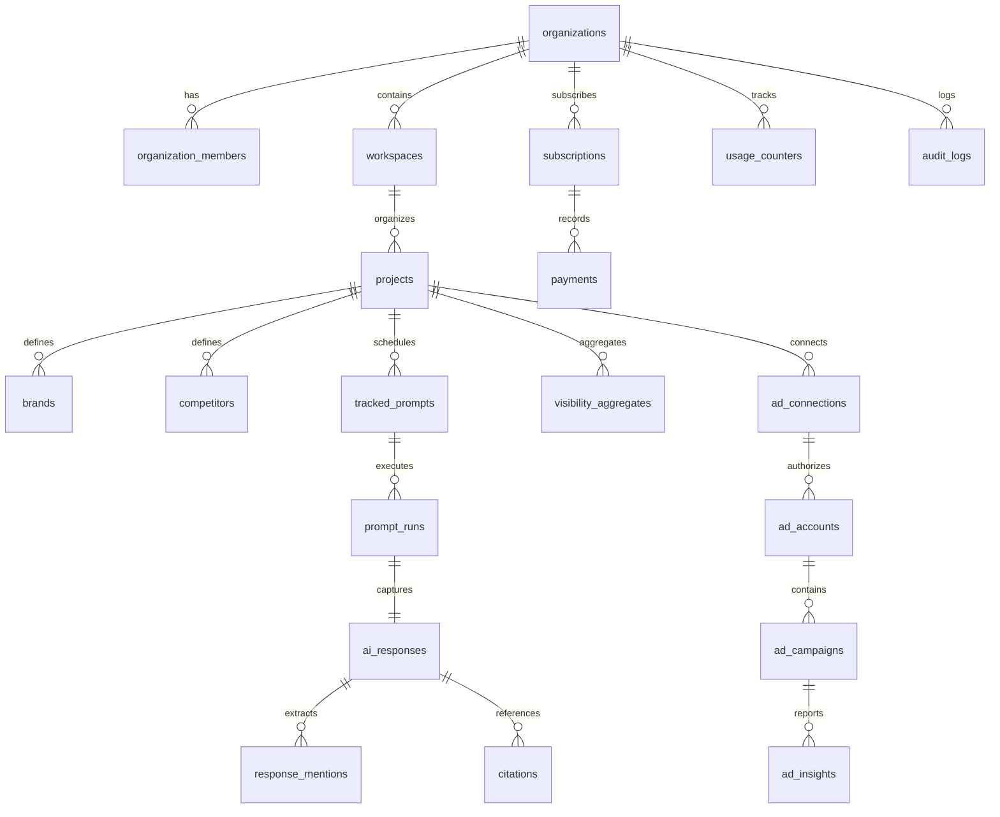

# Visnora — Database Architecture & Schema Specification

**Document Version:** 1.0  
**Baseline Date:** 4 November 2026  
**Document Stage:** Database Design & Data Architecture Baseline  
**Target RDBMS:** PostgreSQL 16+ (Supabase Managed Engine)  
**ORM / Migration Engine:** Prisma ORM  
**Document Owner:** Database Architect & Lead Backend Engineer  
**Repository Context:** `D:\react-native\VISNORA`  

---

## 1. Database Philosophy & Core Standards

The Visnora database architecture is designed for multi-tenant SaaS workloads prioritizing data isolation, auditability, high query performance, and exact financial precision.

### Core Schema Rules:
1. **Primary Keys**: Every internal table uses UUIDv4 (`gen_random_uuid()` in Postgres / `@default(uuid())` in Prisma). Natural keys are prohibited for primary identification.
2. **Multi-Tenant Scoping**: All tenant-owned records carry an `organization_id` column with a foreign key to `organizations(id)`. Cross-tenant queries are blocked by application design and Row Level Security.
3. **Immutability of Audit & Evidence**: Raw LLM payloads (`ai_responses`), audit events (`audit_logs`), and webhook events (`webhook_events`) are write-once, append-only records. Updates to these tables are blocked at the database level.
4. **Time & Timezones**: All timestamps are stored in UTC using `TIMESTAMPTZ` (PostgreSQL `timestamp with time zone`). External ad platform timezones are preserved as string identifiers (e.g., `Asia/Kolkata`, `America/New_York`) to ensure accurate daily boundary calculations.
5. **Financial Precision**: All monetary values (ad spend, subscription pricing, invoice amounts) are stored as integer minor units (`BIGINT` paise or cents) with an explicit ISO 4217 currency code (e.g., `INR`, `USD`). Floating-point arithmetic for money is strictly prohibited.
6. **Data Minimization & Retention**: Raw LLM payloads are retention-capped, while precomputed aggregates persist indefinitely for long-term historical trend reporting.

---

## 2. Entity-Relationship Diagram (ERD)



---

## 3. Comprehensive Entity & Table Specifications

### 3.1 Tenancy & Identity Tables

#### `organizations` (Tenant Root)
```sql
CREATE TABLE organizations (
    id UUID PRIMARY KEY DEFAULT gen_random_uuid(),
    name VARCHAR(255) NOT NULL,
    slug VARCHAR(255) UNIQUE NOT NULL,
    logo_url TEXT,
    billing_email VARCHAR(255) NOT NULL,
    country_code VARCHAR(2) DEFAULT 'IN',
    created_at TIMESTAMPTZ NOT NULL DEFAULT NOW(),
    updated_at TIMESTAMPTZ NOT NULL DEFAULT NOW()
);
CREATE INDEX idx_organizations_slug ON organizations(slug);
```

#### `organization_members` (RBAC & Team Memberships)
```sql
CREATE TYPE org_role AS ENUM ('OWNER', 'ADMIN', 'ANALYST', 'VIEWER');
CREATE TYPE member_status AS ENUM ('INVITED', 'ACTIVE', 'SUSPENDED');

CREATE TABLE organization_members (
    id UUID PRIMARY KEY DEFAULT gen_random_uuid(),
    organization_id UUID NOT NULL REFERENCES organizations(id) ON DELETE CASCADE,
    user_id UUID NOT NULL, -- References Supabase auth.users(id)
    role org_role NOT NULL DEFAULT 'ANALYST',
    status member_status NOT NULL DEFAULT 'ACTIVE',
    invited_by UUID,
    created_at TIMESTAMPTZ NOT NULL DEFAULT NOW(),
    updated_at TIMESTAMPTZ NOT NULL DEFAULT NOW(),
    CONSTRAINT uq_org_user UNIQUE (organization_id, user_id)
);
CREATE INDEX idx_org_members_user ON organization_members(user_id);
CREATE INDEX idx_org_members_org ON organization_members(organization_id);
```

#### `workspaces` (Client Containers)
```sql
CREATE TABLE workspaces (
    id UUID PRIMARY KEY DEFAULT gen_random_uuid(),
    organization_id UUID NOT NULL REFERENCES organizations(id) ON DELETE CASCADE,
    name VARCHAR(255) NOT NULL,
    slug VARCHAR(255) NOT NULL,
    description TEXT,
    created_at TIMESTAMPTZ NOT NULL DEFAULT NOW(),
    updated_at TIMESTAMPTZ NOT NULL DEFAULT NOW(),
    CONSTRAINT uq_org_workspace_slug UNIQUE (organization_id, slug)
);
CREATE INDEX idx_workspaces_org ON workspaces(organization_id);
```

#### `projects` (Brand & Intelligence Focus)
```sql
CREATE TABLE projects (
    id UUID PRIMARY KEY DEFAULT gen_random_uuid(),
    organization_id UUID NOT NULL REFERENCES organizations(id) ON DELETE CASCADE,
    workspace_id UUID NOT NULL REFERENCES workspaces(id) ON DELETE CASCADE,
    name VARCHAR(255) NOT NULL,
    description TEXT,
    primary_website TEXT NOT NULL,
    industry VARCHAR(100),
    target_country VARCHAR(2) DEFAULT 'IN',
    default_language VARCHAR(5) DEFAULT 'en',
    created_at TIMESTAMPTZ NOT NULL DEFAULT NOW(),
    updated_at TIMESTAMPTZ NOT NULL DEFAULT NOW()
);
CREATE INDEX idx_projects_org ON projects(organization_id);
CREATE INDEX idx_projects_workspace ON projects(workspace_id);
```

---

### 3.2 Brand & Competitor Entities

#### `brands` (Canonical Brand & Aliases)
```sql
CREATE TABLE brands (
    id UUID PRIMARY KEY DEFAULT gen_random_uuid(),
    organization_id UUID NOT NULL REFERENCES organizations(id) ON DELETE CASCADE,
    project_id UUID NOT NULL REFERENCES projects(id) ON DELETE CASCADE,
    canonical_name VARCHAR(255) NOT NULL,
    domain VARCHAR(255) NOT NULL,
    aliases TEXT[] NOT NULL DEFAULT '{}',
    is_primary BOOLEAN NOT NULL DEFAULT TRUE,
    created_at TIMESTAMPTZ NOT NULL DEFAULT NOW(),
    updated_at TIMESTAMPTZ NOT NULL DEFAULT NOW()
);
CREATE INDEX idx_brands_project ON brands(project_id);
```

#### `competitors` (Competitor Tracking)
```sql
CREATE TABLE competitors (
    id UUID PRIMARY KEY DEFAULT gen_random_uuid(),
    organization_id UUID NOT NULL REFERENCES organizations(id) ON DELETE CASCADE,
    project_id UUID NOT NULL REFERENCES projects(id) ON DELETE CASCADE,
    canonical_name VARCHAR(255) NOT NULL,
    domain VARCHAR(255) NOT NULL,
    aliases TEXT[] NOT NULL DEFAULT '{}',
    created_at TIMESTAMPTZ NOT NULL DEFAULT NOW(),
    updated_at TIMESTAMPTZ NOT NULL DEFAULT NOW()
);
CREATE INDEX idx_competitors_project ON competitors(project_id);
```

---

### 3.3 Module A: AI Visibility Intelligence Tables

#### `tracked_prompts` (Scheduled Prompt Definitions)
```sql
CREATE TYPE prompt_cadence AS ENUM ('HOURLY', 'DAILY', 'WEEKLY', 'MANUAL');
CREATE TYPE buying_stage AS ENUM ('AWARENESS', 'CONSIDERATION', 'DECISION', 'GENERAL');

CREATE TABLE tracked_prompts (
    id UUID PRIMARY KEY DEFAULT gen_random_uuid(),
    organization_id UUID NOT NULL REFERENCES organizations(id) ON DELETE CASCADE,
    project_id UUID NOT NULL REFERENCES projects(id) ON DELETE CASCADE,
    prompt_text TEXT NOT NULL,
    stage buying_stage NOT NULL DEFAULT 'CONSIDERATION',
    topic_tags TEXT[] NOT NULL DEFAULT '{}',
    target_provider VARCHAR(50) NOT NULL DEFAULT 'google-gemini',
    target_model VARCHAR(50) NOT NULL DEFAULT 'gemini-1.5-flash',
    target_locale VARCHAR(10) NOT NULL DEFAULT 'en-IN',
    cadence prompt_cadence NOT NULL DEFAULT 'DAILY',
    is_active BOOLEAN NOT NULL DEFAULT TRUE,
    last_run_at TIMESTAMPTZ,
    next_run_at TIMESTAMPTZ,
    created_at TIMESTAMPTZ NOT NULL DEFAULT NOW(),
    updated_at TIMESTAMPTZ NOT NULL DEFAULT NOW()
);
CREATE INDEX idx_tracked_prompts_schedule ON tracked_prompts(is_active, next_run_at);
CREATE INDEX idx_tracked_prompts_project ON tracked_prompts(project_id);
```

#### `prompt_runs` (Execution Instances)
```sql
CREATE TYPE run_status AS ENUM ('QUEUED', 'RUNNING', 'COMPLETED', 'FAILED');

CREATE TABLE prompt_runs (
    id UUID PRIMARY KEY DEFAULT gen_random_uuid(),
    organization_id UUID NOT NULL REFERENCES organizations(id) ON DELETE CASCADE,
    project_id UUID NOT NULL REFERENCES projects(id) ON DELETE CASCADE,
    prompt_id UUID NOT NULL REFERENCES tracked_prompts(id) ON DELETE CASCADE,
    provider VARCHAR(50) NOT NULL,
    model_version VARCHAR(100) NOT NULL,
    status run_status NOT NULL DEFAULT 'QUEUED',
    latency_ms INT,
    input_tokens INT,
    output_tokens INT,
    estimated_cost_paise INT DEFAULT 0,
    error_code VARCHAR(100),
    error_message TEXT,
    retry_count INT NOT NULL DEFAULT 0,
    executed_at TIMESTAMPTZ,
    created_at TIMESTAMPTZ NOT NULL DEFAULT NOW()
);
CREATE INDEX idx_prompt_runs_prompt_date ON prompt_runs(prompt_id, created_at DESC);
CREATE INDEX idx_prompt_runs_org ON prompt_runs(organization_id);
```

#### `ai_responses` (Raw & Normalized Response Archive)
```sql
CREATE TABLE ai_responses (
    id UUID PRIMARY KEY DEFAULT gen_random_uuid(),
    organization_id UUID NOT NULL REFERENCES organizations(id) ON DELETE CASCADE,
    prompt_run_id UUID UNIQUE NOT NULL REFERENCES prompt_runs(id) ON DELETE CASCADE,
    raw_payload JSONB NOT NULL,
    normalized_text TEXT NOT NULL,
    payload_hash VARCHAR(64) NOT NULL, -- SHA-256 hash of raw output
    has_citations BOOLEAN NOT NULL DEFAULT FALSE,
    created_at TIMESTAMPTZ NOT NULL DEFAULT NOW()
);
CREATE INDEX idx_ai_responses_run ON ai_responses(prompt_run_id);
```

#### `response_mentions` (Extracted Brand Spans)
```sql
CREATE TYPE mention_type AS ENUM ('PRIMARY_BRAND', 'COMPETITOR', 'OTHER');
CREATE TYPE sentiment_type AS ENUM ('POSITIVE', 'NEUTRAL', 'NEGATIVE', 'NOT_EVALUATED');

CREATE TABLE response_mentions (
    id UUID PRIMARY KEY DEFAULT gen_random_uuid(),
    organization_id UUID NOT NULL REFERENCES organizations(id) ON DELETE CASCADE,
    ai_response_id UUID NOT NULL REFERENCES ai_responses(id) ON DELETE CASCADE,
    matched_entity_id UUID NOT NULL, -- references brands(id) or competitors(id)
    entity_name VARCHAR(255) NOT NULL,
    mention_type mention_type NOT NULL,
    char_start INT NOT NULL,
    char_end INT NOT NULL,
    evidence_text TEXT NOT NULL,
    list_position INT, -- nullable, for numbered/ranked recommendations
    extraction_confidence NUMERIC(3,2) NOT NULL DEFAULT 1.00,
    sentiment sentiment_type NOT NULL DEFAULT 'NOT_EVALUATED',
    created_at TIMESTAMPTZ NOT NULL DEFAULT NOW()
);
CREATE INDEX idx_mentions_response ON response_mentions(ai_response_id);
CREATE INDEX idx_mentions_entity ON response_mentions(matched_entity_id);
```

#### `citations` (Parsed Grounding Sources)
```sql
CREATE TABLE citations (
    id UUID PRIMARY KEY DEFAULT gen_random_uuid(),
    organization_id UUID NOT NULL REFERENCES organizations(id) ON DELETE CASCADE,
    ai_response_id UUID NOT NULL REFERENCES ai_responses(id) ON DELETE CASCADE,
    url TEXT NOT NULL,
    domain VARCHAR(255) NOT NULL,
    citation_order INT NOT NULL DEFAULT 1,
    anchor_text TEXT,
    created_at TIMESTAMPTZ NOT NULL DEFAULT NOW()
);
CREATE INDEX idx_citations_response ON citations(ai_response_id);
CREATE INDEX idx_citations_domain ON citations(domain);
```

#### `visibility_aggregates` (Precalculated Performance Metrics)
```sql
CREATE TABLE visibility_aggregates (
    id UUID PRIMARY KEY DEFAULT gen_random_uuid(),
    organization_id UUID NOT NULL REFERENCES organizations(id) ON DELETE CASCADE,
    project_id UUID NOT NULL REFERENCES projects(id) ON DELETE CASCADE,
    aggregation_date DATE NOT NULL,
    provider VARCHAR(50) NOT NULL,
    total_runs_evaluated INT NOT NULL,
    brand_mentions_count INT NOT NULL,
    observed_mention_rate NUMERIC(5,2) NOT NULL, -- Percentage (0.00 to 100.00)
    sample_share_of_voice NUMERIC(5,2) NOT NULL, -- Percentage (0.00 to 100.00)
    prompt_coverage NUMERIC(5,2) NOT NULL,       -- Percentage (0.00 to 100.00)
    avg_mention_position NUMERIC(4,2),           -- Nullable if unstructured
    created_at TIMESTAMPTZ NOT NULL DEFAULT NOW(),
    CONSTRAINT uq_proj_date_provider UNIQUE (project_id, aggregation_date, provider)
);
CREATE INDEX idx_visibility_agg_lookup ON visibility_aggregates(project_id, aggregation_date);
```

#### `prompt_groups` (Prompt Organization & Categorization — M2)
```sql
CREATE TABLE prompt_groups (
    id UUID PRIMARY KEY DEFAULT gen_random_uuid(),
    organization_id UUID NOT NULL REFERENCES organizations(id) ON DELETE CASCADE,
    project_id UUID NOT NULL REFERENCES projects(id) ON DELETE CASCADE,
    name VARCHAR(255) NOT NULL,
    description TEXT,
    created_at TIMESTAMPTZ NOT NULL DEFAULT NOW(),
    updated_at TIMESTAMPTZ NOT NULL DEFAULT NOW()
);
CREATE INDEX idx_prompt_groups_project ON prompt_groups(project_id);
```

#### `tracking_runs` (Pipeline Execution Orchestration — M2)
```sql
CREATE TABLE tracking_runs (
    id UUID PRIMARY KEY DEFAULT gen_random_uuid(),
    organization_id UUID NOT NULL REFERENCES organizations(id) ON DELETE CASCADE,
    project_id UUID NOT NULL REFERENCES projects(id) ON DELETE CASCADE,
    status VARCHAR(50) NOT NULL DEFAULT 'PENDING',
    provider VARCHAR(50) NOT NULL DEFAULT 'google-gemini',
    model VARCHAR(100) NOT NULL DEFAULT 'gemini-3.8-flash',
    prompt_count INT NOT NULL DEFAULT 0,
    success_count INT NOT NULL DEFAULT 0,
    failed_count INT NOT NULL DEFAULT 0,
    total_input_tokens INT NOT NULL DEFAULT 0,
    total_output_tokens INT NOT NULL DEFAULT 0,
    estimated_cost_paise INT NOT NULL DEFAULT 0,
    actual_cost_paise INT,
    error_message TEXT,
    started_at TIMESTAMPTZ NOT NULL DEFAULT NOW(),
    completed_at TIMESTAMPTZ,
    created_at TIMESTAMPTZ NOT NULL DEFAULT NOW(),
    updated_at TIMESTAMPTZ NOT NULL DEFAULT NOW()
);
CREATE INDEX idx_tracking_runs_project ON tracking_runs(project_id, created_at DESC);
```

#### `recommendations` (Actionable Evidence-Based GEO Strategies — M2)
```sql
CREATE TYPE recommendation_priority AS ENUM ('HIGH', 'MEDIUM', 'LOW');
CREATE TYPE recommendation_status AS ENUM ('NEW', 'IN_PROGRESS', 'COMPLETED', 'DISMISSED');

CREATE TABLE recommendations (
    id UUID PRIMARY KEY DEFAULT gen_random_uuid(),
    organization_id UUID NOT NULL REFERENCES organizations(id) ON DELETE CASCADE,
    project_id UUID NOT NULL REFERENCES projects(id) ON DELETE CASCADE,
    title VARCHAR(255) NOT NULL,
    explanation TEXT NOT NULL,
    evidence TEXT,
    related_metric VARCHAR(100),
    priority recommendation_priority NOT NULL DEFAULT 'MEDIUM',
    suggested_action TEXT NOT NULL,
    status recommendation_status NOT NULL DEFAULT 'NEW',
    created_at TIMESTAMPTZ NOT NULL DEFAULT NOW(),
    updated_at TIMESTAMPTZ NOT NULL DEFAULT NOW()
);
CREATE INDEX idx_recommendations_project ON recommendations(project_id, status);
```

#### `tracking_schedules` (Automated Pipeline Cadence Settings — M2)
```sql
CREATE TABLE tracking_schedules (
    id UUID PRIMARY KEY DEFAULT gen_random_uuid(),
    organization_id UUID NOT NULL REFERENCES organizations(id) ON DELETE CASCADE,
    project_id UUID UNIQUE NOT NULL REFERENCES projects(id) ON DELETE CASCADE,
    frequency VARCHAR(50) NOT NULL DEFAULT 'DAILY',
    provider VARCHAR(50) NOT NULL DEFAULT 'google-gemini',
    model VARCHAR(100) NOT NULL DEFAULT 'gemini-3.8-flash',
    group_id UUID REFERENCES prompt_groups(id) ON DELETE SET NULL,
    is_enabled BOOLEAN NOT NULL DEFAULT TRUE,
    last_run_at TIMESTAMPTZ,
    next_run_at TIMESTAMPTZ,
    created_at TIMESTAMPTZ NOT NULL DEFAULT NOW(),
    updated_at TIMESTAMPTZ NOT NULL DEFAULT NOW()
);
```

#### `ai_usage_records` (Detailed Token Accounting & Cost Auditing — M2)
```sql
CREATE TABLE ai_usage_records (
    id UUID PRIMARY KEY DEFAULT gen_random_uuid(),
    organization_id UUID NOT NULL REFERENCES organizations(id) ON DELETE CASCADE,
    project_id UUID NOT NULL REFERENCES projects(id) ON DELETE CASCADE,
    tracking_run_id UUID REFERENCES tracking_runs(id) ON DELETE SET NULL,
    prompt_run_id UUID REFERENCES prompt_runs(id) ON DELETE SET NULL,
    provider VARCHAR(50) NOT NULL,
    model VARCHAR(100) NOT NULL,
    input_tokens INT NOT NULL DEFAULT 0,
    output_tokens INT NOT NULL DEFAULT 0,
    estimated_cost_paise INT NOT NULL DEFAULT 0,
    actual_cost_paise INT,
    is_estimated BOOLEAN NOT NULL DEFAULT FALSE,
    created_at TIMESTAMPTZ NOT NULL DEFAULT NOW()
);
CREATE INDEX idx_ai_usage_org ON ai_usage_records(organization_id, created_at DESC);
```

---

### 3.4 Module B & C: Ad Intelligence & ChatGPT Ads Tables

#### `ad_connections` (Encrypted Integration Credentials)
```sql
CREATE TYPE ad_platform AS ENUM ('GOOGLE_ADS', 'META_ADS', 'OPENAI_ADS');
CREATE TYPE connection_status AS ENUM ('PENDING', 'ACTIVE', 'EXPIRED', 'REVOKED', 'ERROR');

CREATE TABLE ad_connections (
    id UUID PRIMARY KEY DEFAULT gen_random_uuid(),
    organization_id UUID NOT NULL REFERENCES organizations(id) ON DELETE CASCADE,
    project_id UUID NOT NULL REFERENCES projects(id) ON DELETE CASCADE,
    platform ad_platform NOT NULL,
    account_id_external VARCHAR(255) NOT NULL,
    account_name VARCHAR(255),
    encrypted_credentials BYTEA NOT NULL, -- AES-256-GCM ciphertext
    iv BYTEA NOT NULL,                   -- 12-byte initialization vector
    auth_tag BYTEA NOT NULL,             -- 16-byte authentication tag
    scopes TEXT[] NOT NULL,
    status connection_status NOT NULL DEFAULT 'PENDING',
    expires_at TIMESTAMPTZ,
    last_synced_at TIMESTAMPTZ,
    created_at TIMESTAMPTZ NOT NULL DEFAULT NOW(),
    updated_at TIMESTAMPTZ NOT NULL DEFAULT NOW(),
    CONSTRAINT uq_org_platform_account UNIQUE (organization_id, platform, account_id_external)
);
CREATE INDEX idx_ad_connections_lookup ON ad_connections(organization_id, platform);
```

#### `ad_insights` (First-Party Platform-Reported Metrics)
```sql
CREATE TABLE ad_insights (
    id UUID PRIMARY KEY DEFAULT gen_random_uuid(),
    organization_id UUID NOT NULL REFERENCES organizations(id) ON DELETE CASCADE,
    ad_connection_id UUID NOT NULL REFERENCES ad_connections(id) ON DELETE CASCADE,
    report_date DATE NOT NULL,
    campaign_external_id VARCHAR(255) NOT NULL,
    campaign_name VARCHAR(255) NOT NULL,
    impressions BIGINT NOT NULL DEFAULT 0,
    clicks BIGINT NOT NULL DEFAULT 0,
    spend_paise BIGINT NOT NULL DEFAULT 0, -- Minor units (paise/cents)
    currency VARCHAR(3) NOT NULL DEFAULT 'INR',
    conversions NUMERIC(10,2) NOT NULL DEFAULT 0.00,
    conversion_value_paise BIGINT NOT NULL DEFAULT 0,
    data_class VARCHAR(50) NOT NULL DEFAULT 'platform_reported',
    created_at TIMESTAMPTZ NOT NULL DEFAULT NOW(),
    CONSTRAINT uq_insight_record UNIQUE (ad_connection_id, report_date, campaign_external_id)
);
CREATE INDEX idx_ad_insights_lookup ON ad_insights(ad_connection_id, report_date);
```

#### `public_ad_observations` (Permitted Transparency Records)
```sql
CREATE TABLE public_ad_observations (
    id UUID PRIMARY KEY DEFAULT gen_random_uuid(),
    source_platform VARCHAR(50) NOT NULL, -- 'META_AD_LIBRARY', 'GOOGLE_TRANSPARENCY'
    advertiser_external_id VARCHAR(255) NOT NULL,
    advertiser_name VARCHAR(255) NOT NULL,
    ad_library_id VARCHAR(255) UNIQUE NOT NULL,
    creative_body TEXT,
    media_url TEXT,
    target_domain TEXT,
    first_observed_at TIMESTAMPTZ NOT NULL,
    last_observed_at TIMESTAMPTZ NOT NULL,
    data_class VARCHAR(50) NOT NULL DEFAULT 'public_observed',
    created_at TIMESTAMPTZ NOT NULL DEFAULT NOW()
);
CREATE INDEX idx_public_ad_advertiser ON public_ad_observations(advertiser_name);
```

---

### 3.5 Billing, Subscriptions & Metering Tables (Extended in M4)

#### `subscription_plans` (Tier Definition & Pricing Catalog)
```sql
CREATE TABLE subscription_plans (
    id UUID PRIMARY KEY DEFAULT gen_random_uuid(),
    slug VARCHAR(50) UNIQUE NOT NULL, -- 'free', 'starter', 'pro', 'agency'
    name VARCHAR(100) NOT NULL,
    description TEXT,
    monthly_price_paise INT NOT NULL DEFAULT 0,
    annual_price_paise INT NOT NULL DEFAULT 0,
    currency VARCHAR(3) NOT NULL DEFAULT 'INR',
    prompt_runs_limit INT NOT NULL DEFAULT 100,
    brand_limit INT NOT NULL DEFAULT 1,
    workspace_limit INT NOT NULL DEFAULT 1,
    competitor_limit INT NOT NULL DEFAULT 3,
    features TEXT[] NOT NULL DEFAULT '{}',
    is_active BOOLEAN NOT NULL DEFAULT TRUE,
    is_default BOOLEAN NOT NULL DEFAULT FALSE,
    trial_days INT NOT NULL DEFAULT 14,
    created_at TIMESTAMPTZ NOT NULL DEFAULT NOW(),
    updated_at TIMESTAMPTZ NOT NULL DEFAULT NOW()
);
```

#### `subscriptions` (Subscription Lifecycle & Provider State)
```sql
CREATE TYPE sub_status AS ENUM ('TRIAL', 'ACTIVE', 'PAST_DUE', 'CANCELLED', 'PAUSED', 'EXPIRED', 'SUSPENDED');

CREATE TABLE subscriptions (
    id UUID PRIMARY KEY DEFAULT gen_random_uuid(),
    organization_id UUID UNIQUE NOT NULL REFERENCES organizations(id) ON DELETE CASCADE,
    plan_id UUID REFERENCES subscription_plans(id) ON DELETE SET NULL,
    plan_tier VARCHAR(50) NOT NULL DEFAULT 'STARTER', -- 'FREE', 'STARTER', 'PRO', 'AGENCY'
    billing_cycle VARCHAR(20) NOT NULL DEFAULT 'MONTHLY', -- 'MONTHLY', 'ANNUAL'
    status sub_status NOT NULL DEFAULT 'TRIAL',
    razorpay_customer_id VARCHAR(255),
    razorpay_subscription_id VARCHAR(255) UNIQUE,
    current_period_start TIMESTAMPTZ NOT NULL,
    current_period_end TIMESTAMPTZ NOT NULL,
    cancel_at_period_end BOOLEAN NOT NULL DEFAULT FALSE,
    canceled_at TIMESTAMPTZ,
    effective_cancellation_date TIMESTAMPTZ,
    trial_ends_at TIMESTAMPTZ,
    created_at TIMESTAMPTZ NOT NULL DEFAULT NOW(),
    updated_at TIMESTAMPTZ NOT NULL DEFAULT NOW()
);
CREATE INDEX idx_subscriptions_org ON subscriptions(organization_id);
CREATE INDEX idx_subscriptions_plan ON subscriptions(plan_id);
```

#### `usage_counters` (Plan Quotas & Atomic Reservation)
```sql
CREATE TABLE usage_counters (
    id UUID PRIMARY KEY DEFAULT gen_random_uuid(),
    organization_id UUID NOT NULL REFERENCES organizations(id) ON DELETE CASCADE,
    period_start TIMESTAMPTZ NOT NULL,
    period_end TIMESTAMPTZ NOT NULL,
    prompt_runs_used INT NOT NULL DEFAULT 0,
    prompt_runs_limit INT NOT NULL DEFAULT 100,
    prompt_runs_reserved INT NOT NULL DEFAULT 0,
    ad_syncs_used INT NOT NULL DEFAULT 0,
    ad_syncs_limit INT NOT NULL DEFAULT 30,
    active_projects_count INT NOT NULL DEFAULT 1,
    active_projects_limit INT NOT NULL DEFAULT 2,
    created_at TIMESTAMPTZ NOT NULL DEFAULT NOW(),
    updated_at TIMESTAMPTZ NOT NULL DEFAULT NOW(),
    CONSTRAINT uq_org_period UNIQUE (organization_id, period_start)
);
CREATE INDEX idx_usage_counters_lookup ON usage_counters(organization_id, period_start);
```

#### `usage_records` (Immutable Metering Ledger)
```sql
CREATE TABLE usage_records (
    id UUID PRIMARY KEY DEFAULT gen_random_uuid(),
    organization_id UUID NOT NULL REFERENCES organizations(id) ON DELETE CASCADE,
    usage_type VARCHAR(50) NOT NULL DEFAULT 'PROMPT_RUN',
    quantity INT NOT NULL DEFAULT 1,
    prompt_run_id UUID,
    tracking_run_id UUID,
    idempotency_key VARCHAR(255) UNIQUE,
    period_start TIMESTAMPTZ NOT NULL,
    period_end TIMESTAMPTZ NOT NULL,
    created_at TIMESTAMPTZ NOT NULL DEFAULT NOW()
);
CREATE INDEX idx_usage_records_org_period ON usage_records(organization_id, period_start);
CREATE INDEX idx_usage_records_tracking_run ON usage_records(tracking_run_id);
```

#### `invoices` (Tax Invoices & GST Breakdown)
```sql
CREATE TABLE invoices (
    id UUID PRIMARY KEY DEFAULT gen_random_uuid(),
    organization_id UUID NOT NULL REFERENCES organizations(id) ON DELETE CASCADE,
    subscription_id UUID REFERENCES subscriptions(id) ON DELETE SET NULL,
    invoice_number VARCHAR(100) UNIQUE NOT NULL, -- 'VIS-2026-00001'
    subtotal_paise INT NOT NULL DEFAULT 0,
    tax_paise INT NOT NULL DEFAULT 0,
    total_paise INT NOT NULL DEFAULT 0,
    tax_rate_percent DECIMAL(5,2) NOT NULL DEFAULT 18.00,
    currency VARCHAR(3) NOT NULL DEFAULT 'INR',
    status VARCHAR(50) NOT NULL DEFAULT 'PAID', -- 'PAID', 'PENDING', 'VOID', 'REFUNDED'
    period_start TIMESTAMPTZ NOT NULL,
    period_end TIMESTAMPTZ NOT NULL,
    customer_name VARCHAR(255),
    customer_email VARCHAR(255),
    customer_address TEXT,
    customer_gstin VARCHAR(50),
    pdf_url TEXT,
    created_at TIMESTAMPTZ NOT NULL DEFAULT NOW(),
    updated_at TIMESTAMPTZ NOT NULL DEFAULT NOW()
);
CREATE INDEX idx_invoices_org ON invoices(organization_id);
```

#### `payments` (Payment Transaction History)
```sql
CREATE TABLE payments (
    id UUID PRIMARY KEY DEFAULT gen_random_uuid(),
    subscription_id UUID NOT NULL REFERENCES subscriptions(id) ON DELETE CASCADE,
    organization_id UUID REFERENCES organizations(id) ON DELETE SET NULL,
    invoice_id UUID REFERENCES invoices(id) ON DELETE SET NULL,
    provider VARCHAR(50) NOT NULL DEFAULT 'mock', -- 'mock', 'razorpay'
    razorpay_payment_id VARCHAR(255) UNIQUE,
    provider_payment_id VARCHAR(255),
    idempotency_key VARCHAR(255) UNIQUE,
    amount_paise BIGINT NOT NULL,
    currency VARCHAR(3) NOT NULL DEFAULT 'INR',
    status VARCHAR(50) NOT NULL, -- 'captured', 'failed', 'refunded', 'pending'
    payment_method VARCHAR(50),
    failure_reason TEXT,
    invoice_url TEXT,
    created_at TIMESTAMPTZ NOT NULL DEFAULT NOW()
);
CREATE INDEX idx_payments_sub ON payments(subscription_id);
CREATE INDEX idx_payments_org ON payments(organization_id);
```

#### `webhook_events` (Idempotent Webhook Log)
```sql
CREATE TABLE webhook_events (
    id UUID PRIMARY KEY DEFAULT gen_random_uuid(),
    provider VARCHAR(50) NOT NULL, -- 'RAZORPAY', 'GOOGLE', 'META'
    event_id VARCHAR(255) UNIQUE NOT NULL,
    event_type VARCHAR(100) NOT NULL,
    payload JSONB NOT NULL,
    status VARCHAR(50) NOT NULL DEFAULT 'PENDING',
    processed_at TIMESTAMPTZ,
    error_message TEXT,
    created_at TIMESTAMPTZ NOT NULL DEFAULT NOW()
);
CREATE INDEX idx_webhook_events_lookup ON webhook_events(provider, event_id);
```

#### `audit_logs` (Security & Mutation Trail)
```sql
CREATE TABLE audit_logs (
    id UUID PRIMARY KEY DEFAULT gen_random_uuid(),
    organization_id UUID NOT NULL REFERENCES organizations(id) ON DELETE CASCADE,
    actor_user_id UUID, -- NULL if system-generated
    action VARCHAR(100) NOT NULL, -- 'MEMBER_INVITED', 'CREDENTIAL_CONNECTED', 'PROMPT_DELETED'
    target_entity VARCHAR(50) NOT NULL,
    target_id UUID NOT NULL,
    metadata JSONB NOT NULL DEFAULT '{}',
    ip_address VARCHAR(45),
    created_at TIMESTAMPTZ NOT NULL DEFAULT NOW()
);
CREATE INDEX idx_audit_logs_org_date ON audit_logs(organization_id, created_at DESC);
```

---

## 4. PostgreSQL Row Level Security (RLS) Implementation

Visnora secures database tables with Row Level Security in Supabase PostgreSQL:

```sql
-- Enable RLS on core multi-tenant tables
ALTER TABLE organizations ENABLE ROW LEVEL SECURITY;
ALTER TABLE organization_members ENABLE ROW LEVEL SECURITY;
ALTER TABLE workspaces ENABLE ROW LEVEL SECURITY;
ALTER TABLE projects ENABLE ROW LEVEL SECURITY;
ALTER TABLE tracked_prompts ENABLE ROW LEVEL SECURITY;
ALTER TABLE prompt_runs ENABLE ROW LEVEL SECURITY;
ALTER TABLE ai_responses ENABLE ROW LEVEL SECURITY;
ALTER TABLE visibility_aggregates ENABLE ROW LEVEL SECURITY;
ALTER TABLE ad_connections ENABLE ROW LEVEL SECURITY;

-- Helper function to inspect current user's organization memberships
CREATE OR REPLACE FUNCTION auth.get_user_organizations()
RETURNS SETOF UUID AS $$
    SELECT organization_id 
    FROM organization_members 
    WHERE user_id = auth.uid() 
      AND status = 'ACTIVE';
$$ LANGUAGE sql SECURITY DEFINER;

-- Policy Example: Projects isolation
CREATE POLICY org_isolation_projects_policy ON projects
    FOR ALL
    USING (organization_id IN (SELECT auth.get_user_organizations()))
    WITH CHECK (organization_id IN (SELECT auth.get_user_organizations()));

-- Policy Example: Tracked Prompts isolation
CREATE POLICY org_isolation_prompts_policy ON tracked_prompts
    FOR ALL
    USING (organization_id IN (SELECT auth.get_user_organizations()))
    WITH CHECK (organization_id IN (SELECT auth.get_user_organizations()));
```

---

## 5. Migration Strategy & Prisma ORM Workflow
1. **Schema Authority**: The canonical database schema is authored in `packages/database/prisma/schema.prisma`.
2. **Migration Generation**: Local development changes generate declarative SQL migration scripts:
   ```bash
   npx prisma migrate dev --name <descriptive_name>
   ```
3. **Continuous Deployment Migration**: Migrations run during build/deployment verification:
   ```bash
   npx prisma migrate deploy
   ```
4. **Zero Downtime Constraint**: Migrations adding columns must use `NULL` or provide safe `DEFAULT` values to ensure backward compatibility.

### 5.1 Milestone M1 SaaS Foundation Extensions
- **Migration Location**: `packages/database/prisma/migrations/20261106_m1_saas_foundation/migration.sql`
- **Extended Tables**:
  - `organizations`: Added `website VARCHAR(255)` and `org_type VARCHAR(50) DEFAULT 'business'`.
  - `workspaces`: Added `is_archived BOOLEAN NOT NULL DEFAULT false`.
  - `projects`: Added `is_archived BOOLEAN NOT NULL DEFAULT false`.
- **New Tables**:
  - `invitations`: `id UUID PK`, `organization_id UUID FK`, `email VARCHAR(255)`, `role org_role`, `token VARCHAR(255) UNIQUE`, `status invitation_status DEFAULT 'PENDING'`, `expires_at TIMESTAMPTZ`, `invited_by UUID`, `created_at TIMESTAMPTZ`.
  - `user_profiles`: `id UUID PK`, `email VARCHAR(255) UNIQUE`, `full_name VARCHAR(255)`, `avatar_url TEXT`, `company VARCHAR(255)`, `created_at TIMESTAMPTZ`, `updated_at TIMESTAMPTZ`.
- **RLS Functions & Hardened Isolation Policies**:
  - `public.is_org_member(target_org_id UUID)`
  - `public.is_org_admin(target_org_id UUID)`
  - `public.is_org_owner(target_org_id UUID)`
  - RLS policies applied to `organizations`, `organization_members`, `workspaces`, `projects`, `invitations`, and `user_profiles`.

### 5.2 Milestone M5 Competitor Ad Intelligence Extensions
- **Migration Location**: `packages/database/prisma/migrations/20261112_m5_ad_intelligence/migration.sql`
- **Extended Enums**:
  - `AdPlatform`: Added `'TIKTOK_ADS'`, `'MANUAL'`, `'OTHER'`.
  - Added enums: `AdSourceType` (`META_AD_LIBRARY`, `GOOGLE_ADS_TRANSPARENCY`, `TIKTOK_CREATIVE_CENTER`, `MANUAL_SUBMISSION`), `AdFormat` (`IMAGE`, `VIDEO`, `CAROUSEL`, `TEXT`, `UNKNOWN`), `AdStatus` (`ACTIVE`, `INACTIVE`, `UNKNOWN`, `REMOVED`).
- **New Tables**:
  - `ad_sources`: Configured ad research sources.
  - `ad_records`: Core normalized ad records with canonical SHA-256 `content_hash` and unique index on `[organization_id, platform, external_ad_id]`.
  - `ad_creatives`: Individual media creative assets (Image, Video, Carousel, Text).
  - `ad_landing_pages`: Extracted destination URLs, normalized domain, status, and detected offers.
  - `ad_snapshots`: Point-in-time creative captures for change detection.
  - `ad_analyses`: 12-dimension AI strategic and positioning analyses with token and cost accounting in Paise.
  - `ad_monitoring_jobs`: Automated scheduled recurring competitor checks.
  - `ad_change_events`: Historical audit log of detected modifications (`NEW_AD`, `HEADLINE_CHANGED`, `TEXT_CHANGED`, `CTA_CHANGED`, `LANDING_PAGE_CHANGED`, `REMOVED`).
  - `ad_comparisons`: Persisted side-by-side multi-ad comparisons with synthesized AI summaries.
  - `ad_recommendations`: Actionable evidence-backed recommendations across 9 marketing categories.
  - `ad_collection_runs`: Ingestion pipeline execution history.

### 5.3 Milestone M6 ChatGPT Ads Intelligence Extensions
- **Migration Location**: `packages/database/prisma/migrations/20261112_m6_chatgpt_ads/migration.sql`
- **Architectural Scope**: Integration with OpenAI Ads API (`https://api.ads.openai.com`), AES-256-GCM credential vaulting, conversational ad preview & generation, conversion tracking (Pixel & CAPI), and 12-dimension AI optimization engine.
- **Extended Enums**:
  - `ChatGPTAdsCampaignStatus`: `'PAUSED'`, `'ACTIVE'`, `'COMPLETED'`, `'ARCHIVED'`. Strict safety default is `'PAUSED'`.
  - `ChatGPTAdsAdStatus`: `'PAUSED'`, `'ACTIVE'`, `'PENDING_REVIEW'`, `'DISAPPROVED'`, `'ARCHIVED'`.
  - `ChatGPTAdsSyncStatus`: `'SUCCESS'`, `'PARTIAL'`, `'FAILED'`, `'IN_PROGRESS'`.
  - `ChatGPTAdsRecStatus`: `'PENDING'`, `'APPROVED'`, `'APPLIED'`, `'REJECTED'`.
  - `ChatGPTAdsRecDimension`: 12 dimensions: `'BID_STRATEGY'`, `'BUDGET_REALLOCATION'`, `'TARGETING_EXPANSION'`, `'CONTEXT_HINT_OPTIMIZATION'`, `'KEYWORD_EXCLUSION'`, `'CREATIVE_REFRESH'`, `'HEADLINE_VARIATION'`, `'CTA_TUNING'`, `'CONVERSION_RATE_OPTIMIZATION'`, `'AD_SCHEDULE'`, `'AUDIENCE_SEGMENTATION'`, `'ANOMALY_CORRECTION'`.
- **New Tables (13 Total)**:
  1. `chatgpt_ads_accounts`: Authorized OpenAI Ads advertiser accounts (`id`, `organization_id`, `openai_account_id`, `account_name`, `currency`, `timezone`, `status`, `last_sync_at`, `data_freshness_info`).
  2. `chatgpt_ads_credentials`: Encrypted credential vault (`id`, `organization_id`, `account_id`, `encrypted_access_token`, `key_fingerprint`, `iv`, `auth_tag`, `last_rotated_at`, `expires_at`).
  3. `chatgpt_ads_campaigns`: ChatGPT advertising campaigns (`id`, `organization_id`, `account_id`, `openai_campaign_id`, `name`, `status`, `budget_amount_paise`, `currency`, `start_date`, `end_date`, `targeting_config`).
  4. `chatgpt_ads_ad_groups`: Context-targeted conversational ad groups (`id`, `organization_id`, `campaign_id`, `openai_ad_group_id`, `name`, `status`, `bid_amount_paise`, `context_hints`, `audience_config`).
  5. `chatgpt_ads_ads`: Individual conversational ads (`id`, `organization_id`, `ad_group_id`, `openai_ad_id`, `headline`, `ad_copy`, `advertiser_name`, `destination_url`, `display_url`, `call_to_action`, `status`).
  6. `chatgpt_ads_assets`: Creative media, brand cards, logos (`id`, `organization_id`, `account_id`, `openai_asset_id`, `asset_type`, `asset_url`, `content_hash`, `file_size_bytes`, `mime_type`).
  7. `chatgpt_ads_insights`: Time-series performance metrics with delayed data tracking (`id`, `organization_id`, `account_id`, `campaign_id`, `ad_group_id`, `ad_id`, `date`, `impressions`, `clicks`, `spend_paise`, `conversions`, `delayed_data_status`).
  8. `chatgpt_ads_conversions`: Measurement pixel & CAPI conversion registry (`id`, `organization_id`, `account_id`, `event_name`, `event_source`, `event_time`, `dedup_key` [48hr SHA-256], `value_paise`, `currency`, `user_data_hash`).
  9. `chatgpt_ads_events`: Live event ingestion audit log for pixel & server-side diagnostics (`id`, `organization_id`, `conversion_id`, `event_type`, `raw_payload`, `received_at`).
  10. `chatgpt_ads_sync_runs`: Remote sync execution ledger (`id`, `organization_id`, `account_id`, `sync_type`, `status`, `records_synced`, `error_details`, `started_at`, `completed_at`).
  11. `chatgpt_ads_recommendations`: 12-dimension AI optimization engine recommendations (`id`, `organization_id`, `account_id`, `campaign_id`, `dimension`, `title`, `description`, `action_payload`, `status`, `applied_at`).
  12. `chatgpt_ads_alerts`: Anomaly detection and threshold alert feed (`id`, `organization_id`, `account_id`, `severity`, `title`, `message`, `is_acknowledged`, `created_at`).
  13. `chatgpt_ads_audit_logs`: Immutable security audit log for all credential, campaign, and financial actions (`id`, `organization_id`, `user_id`, `action`, `resource_type`, `resource_id`, `details`, `ip_address`, `created_at`).

---

## 6. Cross-Reference Navigation
- **Product Requirements**: [PRD.md](file:///D:/react-native/VISNORA/docs/PRD.md)
- **Technical Blueprint**: [TECHNICAL_BLUEPRINT.md](file:///D:/react-native/VISNORA/docs/TECHNICAL_BLUEPRINT.md)
- **Architecture Specification**: [ARCHITECTURE.md](file:///D:/react-native/VISNORA/docs/ARCHITECTURE.md)
- **API Contracts**: [API_CONTRACT.md](file:///D:/react-native/VISNORA/docs/API_CONTRACT.md)
- **Security Blueprint**: [SECURITY.md](file:///D:/react-native/VISNORA/docs/SECURITY.md)
- **Data Provenance**: [DATA_METHODOLOGY.md](file:///D:/react-native/VISNORA/docs/DATA_METHODOLOGY.md)
- **Development Roadmap**: [ROADMAP.md](file:///D:/react-native/VISNORA/docs/ROADMAP.md)
- **Integration Feasibility**: [INTEGRATIONS.md](file:///D:/react-native/VISNORA/docs/INTEGRATIONS.md)
- **Coding Guidelines**: [DEVELOPMENT_GUIDELINES.md](file:///D:/react-native/VISNORA/docs/DEVELOPMENT_GUIDELINES.md)

